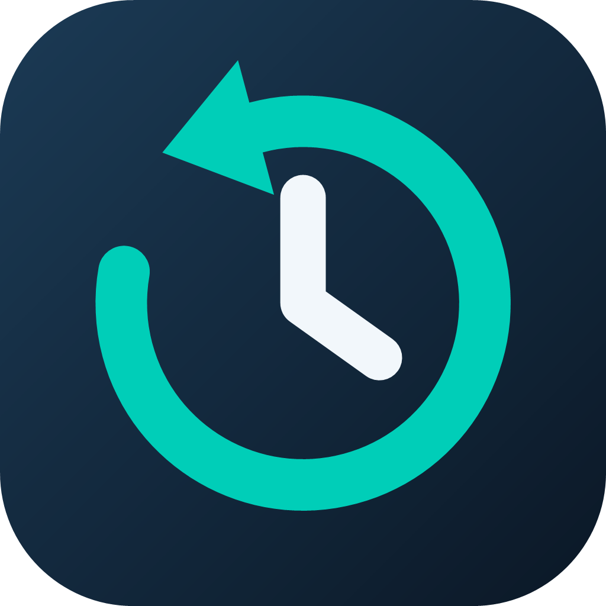

<p align="center"></p>

# Offer History for Sleeper

A Chrome extension that remembers every trade offer you've sent or received on
[Sleeper](https://sleeper.com) and shows them **right where you build a new trade** - so you never send
the same offer twice.

> Unofficial. Not affiliated with or endorsed by Sleeper. It only reads what Sleeper already shows your
> account, and it never sends, accepts, rejects or changes a trade.

## What it does

When you open **Trade -> Propose Trade**, pick a partner and start adding players or picks, an
**Offer History** card appears in the trade summary:

- **Repeat warning** - "You have already made this exact offer", or a very similar one, with its outcome and date.
  It updates live as you add or remove assets.
- **Full history with that owner** - every past offer, sent *and* received, with the outcome
  (Accepted, Rejected, Pending, Cancelled, Failed), the date, and who gets what - including draft picks.
- **Clickable filters** - the pills at the top (accepted / rejected / pending / cancelled) filter the list.
- **Works everywhere** - classic and new ("beta") Sleeper layouts; dark and light mode; redraft, keeper and
  dynasty leagues. For leagues that carry over, it follows the league back through earlier seasons.
- **Keeps its own copy** - history is saved in your browser, so it doesn't depend on what Sleeper
  chooses to show (the classic *Trade History* screen only exists in leagues with a trade-review period).

## Install

You need Chrome, Edge, Brave or another Chromium browser, version 111 or newer.

1. Go to the **[Releases](https://github.com/gregdobs/offer-history-for-sleeper/releases/latest)** page and download
   `offer-history-for-sleeper-v1.0.0.zip` (the file under *Assets*, not "Source code").
2. **Unzip** it to a folder you'll keep (for example `Documents\offer-history-for-sleeper`).
   The browser loads the extension from that folder, so don't delete it afterwards.
3. Open `chrome://extensions` (Edge: `edge://extensions`) and turn on **Developer mode** (top right).
4. Click **Load unpacked** and choose the unzipped folder - the one that contains `manifest.json`.
5. Open [sleeper.com](https://sleeper.com) (reload the tab if it was already open).

Open each of your leagues once so the extension can collect its history; after that, the card appears
whenever you build a trade.

### Updating

Download the newer zip, unzip it **over the same folder** (replace the files), then click the refresh
icon on the extension's card in `chrome://extensions` and reload Sleeper. Your saved history is kept.

### Uninstalling

Click **Remove** on the extension's card. This deletes the saved history too.

## How to use it

1. In a league, open **Trades** (classic) or the **Trade** tab (new layout) and start a proposal.
2. Choose your trade partner(s). The **Offer History** card appears under *Trade Summary* (classic) or below
   the summary (new layout).
3. Add the players or picks you're considering. A warning box appears if it matches something you've already offered.
4. Click a pill (for example **rejected**) to filter the list; click it again to clear the filter.

## Privacy

- Everything is stored **locally** in your browser (`chrome.storage.local`). There is no server, no account,
  no analytics and no tracking.
- The extension only runs on `https://sleeper.com/*`. Besides Sleeper's own requests that the page already
  makes, it asks Sleeper's public API (`api.sleeper.app`) for league names, members and the player list, and it
  re-requests your own trade list from `sleeper.com/graphql` using the same session the page already uses.
- Your Sleeper login details are never read, stored or sent anywhere by the extension.
- To erase everything, remove the extension.

## Known limits

- History appears for a league **after you have opened it** with the extension installed (it can't see offers
  Sleeper hasn't loaded). Older seasons of a league are fetched for you when possible.
- Draft picks are compared by **year and round**, not by which team originally owned the pick.
- It relies on how Sleeper's website currently works. If Sleeper changes its pages, the card may stop
  appearing until the extension is updated - please [open an issue](https://github.com/gregdobs/offer-history-for-sleeper/issues).
- The classic layout has no light mode, so the card is dark there.

## Troubleshooting

| Symptom | Try |
| --- | --- |
| No card in the trade screen | Reload the Sleeper tab; confirm the extension is enabled in `chrome://extensions`; make sure you're on `sleeper.com`. |
| "No past offers" but you know there are some | Open the league's page once and reload so the extension can collect its history, then try again. |
| Footer says it couldn't refresh from Sleeper | The card still shows what's saved. Reload Sleeper to renew the session, then reopen the trade screen. |
| Card looks wrong after a Sleeper update | Report it in [Issues](https://github.com/gregdobs/offer-history-for-sleeper/issues) with the layout (classic/new) and a screenshot (hide player names if you like). |

## Development

```text
extension/   the extension itself (Manifest V3; no build step)
  inject.js  runs in the page; copies Sleeper's own trade data and (on request) re-asks for it
  content.js stores history, matches offers, and draws the card (classic + new layout)
tests/       browser test suite that runs on dummy data (no Sleeper account needed)
tools/       make-icons.ps1 (icon generator) and package.ps1 (builds the release zip)
```

Run the tests (needs Python 3 and a Chromium browser):

```powershell
python tests/server.py
# then open http://127.0.0.1:8765/tests/test.html - all tests should be green
```

Build the release zip (Windows PowerShell):

```powershell
powershell -ExecutionPolicy Bypass -File tools\package.ps1
```

## License

[MIT](LICENSE)
